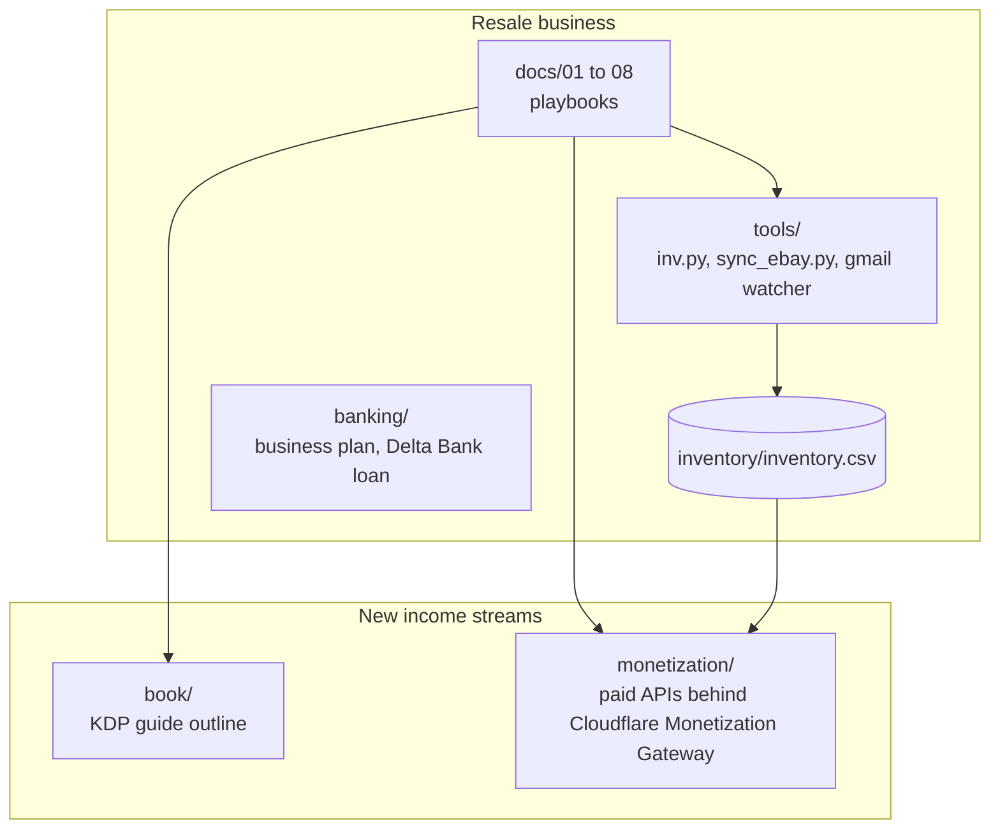
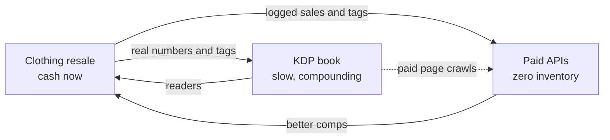
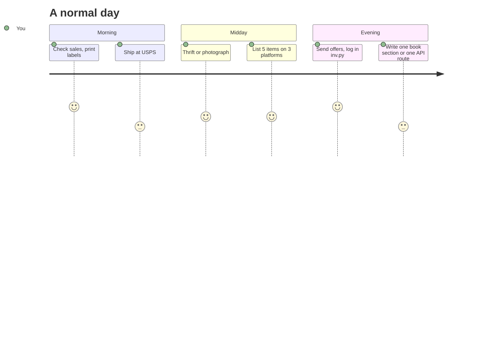

# clothing_resale

Online clothing resale business (vintage sports, men's, women's): cheap sourcing, platform strategy, cross-platform inventory tracking, USPS shipping, and a bank-ready business plan.

| Doc | What it covers |
|-----|----------------|
| [docs/01-sourcing.md](docs/01-sourcing.md) | Where to buy cheap inventory (wholesale vintage, liquidation lots, bins, local, online) and what to pay |
| [docs/02-platforms.md](docs/02-platforms.md) | Which marketplaces to sell on, fees, and which items go where |
| [docs/03-inventory-system.md](docs/03-inventory-system.md) | SKU system, crosslisting, and how to never double-sell |
| [docs/04-shipping-usps.md](docs/04-shipping-usps.md) | USPS service picks, packaging, and label workflow |
| [docs/05-launch-checklist.md](docs/05-launch-checklist.md) | 30-day plan from zero to first 100 listings |
| [docs/06-pricing-and-grading.md](docs/06-pricing-and-grading.md) | Condition grading, spotting real vintage, pricing comps |
| [docs/07-automation.md](docs/07-automation.md) | Automatic sale detection: eBay API sync, Gmail sale-email watcher, crosslister option |
| [docs/08-sell-fast.md](docs/08-sell-fast.md) | Turnover playbook: avoiding ad fees, fastest channels, staleness schedule |
| [banking/business-plan.md](banking/business-plan.md) | Full business plan with projections, Gantt and process charts |
| [banking/delta-bank-loan.md](banking/delta-bank-loan.md) | How to get a small loan from Delta Bank, packet checklist |

## Inventory tracker

`inventory/inventory.csv` is the single source of truth. Every item gets one SKU; that SKU goes in every listing on every platform.

```
python tools/inv.py init
python tools/inv.py add --brand Starter --item "Bulls satin jacket" --cat mens --type jacket --size XL --cost 12 --price 85
python tools/inv.py listed CR-0001 ebay depop     # record where it's listed
python tools/inv.py list                          # everything in stock, flags 60+ day items
python tools/inv.py sold CR-0001 ebay 79.99       # marks sold, tells you where to delist
python tools/inv.py ship CR-0001 6.40             # record shipping cost
python tools/inv.py report                        # revenue, COGS, fees, profit, sell-through
python tools/sync_ebay.py                         # auto-mark eBay sales sold (see docs/07)
```

Open the CSV in Excel or Google Sheets any time. The script only keeps it consistent. Python 3.8+, no dependencies.

## Repo map



## Income streams and how they feed each other



## Other folders

| Folder | What it covers |
|---|---|
| [book/outline.md](book/outline.md) | 16-chapter KDP book drafted from these docs, with writing schedule |
| [monetization/README.md](monetization/README.md) | Paid API plan: Cloudflare Monetization Gateway, x402, Worker skeleton, revenue math |
| [tools/README.md](tools/README.md) | How the three scripts fit together |
| [inventory/README.md](inventory/README.md) | CSV schema |

## Day in the life


