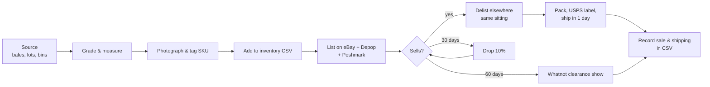
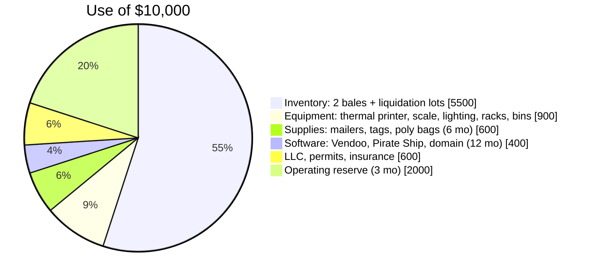
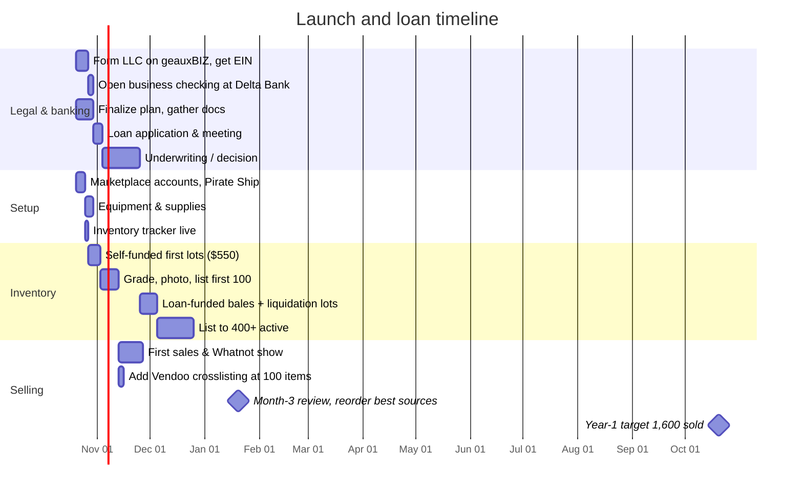

# Business Plan: [Your Brand] Clothing Resale, LLC

**Prepared for:** Delta Bank, small business lending
**Prepared by:** [Your name], Owner
**Date:** October 2026
**Loan request:** $10,000 term loan (36 months) or business line of credit

> Fill in bracketed fields. Numbers below are conservative projections built from documented supplier prices and platform fees (see `docs/`). Update them with your own first-60-day sales data before the bank meeting; lenders weight real sales far above projections.

---

## 1. Executive summary

[Your Brand] buys secondhand and vintage clothing at $2–$12 per piece from wholesale vintage suppliers, liquidation lots, and by-the-pound thrift outlets, then sells it online at $25–$80 per piece through eBay, Depop, Poshmark, and Whatnot. Inventory is tracked in a single SKU system across all platforms and shipped via USPS.

The business is capital-efficient: there is no storefront, no employees at launch, and inventory turns in roughly 45–90 days. The requested $10,000 funds a one-time inventory build (two bales and several liquidation lots), photography and shipping equipment, and three months of operating reserve. Projected first-year revenue is $62,000 with net profit of $19,000 after paying the loan.

| | Year 1 | Year 2 |
|---|---|---|
| Items sold | 1,600 | 3,200 |
| Revenue | $62,400 | $128,000 |
| Net profit (after loan payments) | $19,100 | $46,000 |
| Owner hours/week | 25 | 40 |

## 2. Company description

- **Legal form:** Louisiana LLC (single-member), registered via geauxBIZ. EIN obtained.
- **Location:** Home-based, Monroe, LA (Ouachita Parish). Inventory stored in a dedicated room / garage, ~150 sq ft.
- **Products:** Vintage sportswear (team jackets, jerseys, tees), men's workwear and outdoor brands, women's contemporary and vintage apparel, bags and shoes.
- **Mission:** Keep good clothing out of landfills and put it in front of the buyers who want it, at a fair price, shipped fast.

## 3. Market

The US secondhand apparel market is roughly $50 billion and growing about three times faster than retail apparel overall, driven by Gen Z and millennial buyers on Depop, Poshmark, and eBay (thredUP annual Resale Report). Vintage sports apparel is a durable niche: 90s Starter jackets, Champion reverse weave, and single-stitch team tees sell for $40–$200 to collectors nationwide.

**Target customers**
1. Men 18–40 buying vintage sports and workwear on eBay, Grailed, Depop.
2. Women 18–35 buying contemporary brands (Free People, Lululemon, Madewell) and 90s/Y2K vintage on Poshmark and Depop.
3. Bargain and bulk buyers on Whatnot live auctions.

**Competition:** Thousands of individual resellers, most of whom source only from local thrift stores and list on one platform. Our edge is wholesale sourcing (lower cost per piece), multi-platform listing (more buyers per item), and disciplined inventory turnover (price drops at 30/60/90 days).

## 4. Operations

- **Sourcing:** Thrift Vintage Fashion (FL) and LA Vintage bales for sports; BULQ / Via Trading liquidation lots and thredUP Rescue boxes for women's; Goodwill outlet bins and estate sales locally. Details and prices in `docs/01-sourcing.md`.
- **Selling:** eBay (anchor), Depop (near-zero fees), Poshmark (women's), Whatnot (clearance). `docs/02-platforms.md`.
- **Inventory control:** one SKU per item, single CSV source of truth, delist-on-sale rule, Vendoo crosslister at 100+ listings. `docs/03-inventory-system.md`.
- **Shipping:** USPS Ground Advantage default, Priority Flat Rate for heavy, labels via marketplace or Pirate Ship at commercial rates, daily USPS pickup. `docs/04-shipping-usps.md`.

## 5. Unit economics

Average item, blended across categories:

| Line | Amount |
|---|---|
| Sale price | $39.00 |
| Platform fees (~12% blended) | –$4.70 |
| Shipping (Ground Advantage, free to buyer) | –$5.50 |
| Packaging | –$0.30 |
| Cost of goods (blended) | –$6.00 |
| **Gross profit per item** | **$22.50** (58%) |

At 130 items sold per month (about 4 per day), gross profit is ~$2,900/month before overhead and loan payment.

## 6. Use of loan funds

Inventory at $5,500 buys roughly 900 pieces at a blended $6 landed cost, which at a 60% sell-through over six months yields ~$21,000 revenue, covering the loan more than twice over.

## 7. Financial projections, year 1

Assumptions: start with 150 pieces in month 1, scale sourcing with cash flow, 55–65% sell-through within 90 days, $39 average sale, 12% fees, $5.80 shipping+packaging, $6 blended COGS, loan payment $310/month (36 mo at ~7.5%, verify with Delta Bank), overhead $150/month (software, supplies, mileage, insurance).

| Month | Listed | Sold | Revenue | Fees+Ship | COGS | Overhead | Loan | Net |
|---|---|---|---|---|---|---|---|---|
| 1 | 150 | 40 | $1,560 | $419 | $240 | $150 | $310 | $441 |
| 2 | 280 | 75 | $2,925 | $786 | $450 | $150 | $310 | $1,229 |
| 3 | 380 | 100 | $3,900 | $1,048 | $600 | $150 | $310 | $1,792 |
| 4 | 450 | 120 | $4,680 | $1,258 | $720 | $150 | $310 | $2,242 |
| 5 | 500 | 135 | $5,265 | $1,415 | $810 | $150 | $310 | $2,580 |
| 6 | 520 | 145 | $5,655 | $1,520 | $870 | $150 | $310 | $2,805 |
| 7 | 540 | 150 | $5,850 | $1,572 | $900 | $150 | $310 | $2,918 |
| 8 | 550 | 150 | $5,850 | $1,572 | $900 | $150 | $310 | $2,918 |
| 9 | 560 | 155 | $6,045 | $1,625 | $930 | $150 | $310 | $3,030 |
| 10 | 580 | 165 | $6,435 | $1,730 | $990 | $150 | $310 | $3,255 |
| 11 | 600 | 180 | $7,020 | $1,887 | $1,080 | $150 | $310 | $3,593 |
| 12 | 600 | 185 | $7,215 | $1,939 | $1,110 | $150 | $310 | $3,706 |
| **Total** | | **1,600** | **$62,400** | **$16,771** | **$9,600** | **$1,800** | **$3,720** | **$30,509** |

Owner draw and income tax come out of the net line; after a $950/month owner draw, retained profit is ~$19,100. Break-even is month 1 at just 25 sales. Debt-service coverage ratio (net before loan ÷ loan payment) averages 9x, well above the 1.25x most lenders want.

**Sensitivity:** if average sale drops to $30 and sell-through to 45%, year-1 net before loan is still ~$14,000, covering the $3,720 annual debt service 3.8x.

## 8. Timeline

## 9. Management

[Your name], owner-operator. [2–3 sentences: relevant background, e.g. retail, logistics, prior reselling, marketing. Mention existing USPS business account and any prior eBay/Depop feedback score.] Bookkeeping via Wave or QuickBooks Self-Employed; CPA engaged at tax time.

## 10. Risks and mitigation

| Risk | Mitigation |
|---|---|
| Bale quality worse than expected | Order sample lots first; split first bale with another reseller; budget assumes one-third rag |
| Platform fee or policy changes | Four platforms, no dependence on one; CSV data portable |
| Slow sell-through ties up cash | 30/60/90-day price-drop rule; weekly Whatnot clearance |
| Returns and fakes | Measurements on every listing; authenticity check before listing; 30-day return policy priced in |
| Owner illness / time | Lean operation; all processes documented in this repo |

## 11. Appendix

- Supplier price evidence: `docs/01-sourcing.md`
- Platform fee evidence: `docs/02-platforms.md`
- Inventory tracker and sales log: `inventory/inventory.csv`, `tools/inv.py`
- Loan application checklist: `banking/delta-bank-loan.md`
