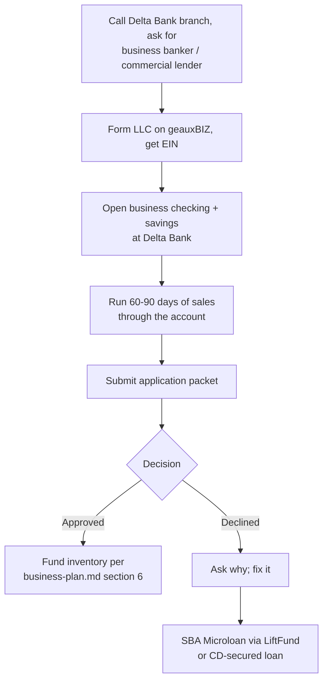

# Getting a small loan from Delta Bank

Delta Bank is a Louisiana community bank. Community banks make relationship loans: they will weigh your deposit history, your plan, and your personal credit more than an algorithm would. I could not find Delta Bank's small-business loan terms published online, so step one is a phone call. Everything below is what to ask and what to bring.

## What to ask for

| Option | Typical size | Best when |
|---|---|---|
| **Business term loan** | $5,000–$25,000, 2–5 yr | You want one inventory build and fixed payments. Ask for $10,000 / 36 mo. |
| **Business line of credit** | $5,000–$25,000, revolving | You want to draw for each bale and pay down as it sells. Better fit for resale cash cycles. Ask for this first. |
| **SBA 7(a) Small loan** via the bank | up to $350,000, usually $25k+ | Only if Delta Bank is an SBA lender and you want more than $25k later. |
| **SBA Microloan** (not through the bank) | up to $50,000, avg ~$15k | Fallback if the bank declines a startup. Louisiana intermediaries include LiftFund and similar nonprofits; 620+ credit preferred, collateral and personal guarantee usual. |
| **Secured personal loan / CD-secured loan** | any | Fallback with no business history: borrow against a CD or savings at Delta Bank at a low rate. |

Realistic expectation: a startup with no revenue history usually gets a **personal guarantee loan** priced on your personal credit, or a CD/savings-secured loan. Two to three months of real sales in the inventory CSV changes that conversation a lot. If you can, open the account now, run sales through it for 60–90 days, then apply.

## Steps

1. **Call the branch.** Ask: "Do you offer small business term loans or lines of credit under $25,000 for a new LLC? Are you an SBA lender? What do you need from me?" Write down the banker's name.
2. **Form the LLC** at geauxbiz.sos.la.gov (~$100) and get a free EIN at irs.gov. Takes a day.
3. **Open business checking** at Delta Bank. Deposit your starting capital. All sales payouts go here.
4. **Build 60–90 days of history** if you can wait. Even $3,000 in deposits with the CSV to back it up is strong evidence.
5. **Submit the packet** below.

## Application packet checklist

- [ ] `banking/business-plan.md` printed, bracketed fields filled, projections updated with real sales
- [ ] LLC articles of organization and EIN letter
- [ ] Louisiana sales tax registration (LaTAP)
- [ ] Personal tax returns, last 2 years
- [ ] Personal financial statement (bank will give you their form: assets, debts, income)
- [ ] 3 months personal bank statements, plus business statements if any
- [ ] Credit report pulled yourself first (annualcreditreport.com) so there are no surprises; dispute errors before applying
- [ ] Inventory report: `python tools/inv.py report` output, and the CSV
- [ ] Screenshots of eBay/Depop/Poshmark sales dashboards and feedback
- [ ] Supplier quotes or receipts (Thrift Vintage Fashion, BULQ, LA Vintage)
- [ ] Use-of-funds table (plan section 6) and repayment schedule (plan section 7)
- [ ] Collateral list if asked: equipment, inventory at cost, vehicle, or a CD

## Questions the banker will ask, with answers

- **Why do you need the money?** One-time inventory build of ~900 pieces at ~$6 landed cost, plus equipment. Inventory turns in 45–90 days, so the loan is self-liquidating.
- **How will you repay it?** Projected net before loan payment averages $2,800/month; the payment is ~$310. Coverage is 9x. Worst case (plan sensitivity) still covers 3.8x.
- **What if it doesn't sell?** 30/60/90-day price drops and weekly Whatnot clearance. Clothing always has a floor price; worst case recovers cost of goods.
- **What's your experience?** [Your answer. Mention USPS account, any prior selling, this documented system.]
- **What are you putting in?** State your own cash in: the $550 first lots, equipment you already own, and sweat equity. Banks like to see 10–25% owner contribution.

## Terms to compare if you get an offer

Rate (fixed or variable), term, monthly payment, origination fee, prepayment penalty, personal guarantee, collateral required, and whether it reports to business credit bureaus (good for the future).

Sources: [SBA Microloans](https://www.sba.gov/funding-programs/loans/microloans), [SBA microloan eligibility](https://www.nerdwallet.com/business/loans/learn/sba-microloans), [Louisiana small business loans 2026](https://www.crestmontcapital.com/blog/small-business-loans-in-louisiana-complete-2026-guide).
