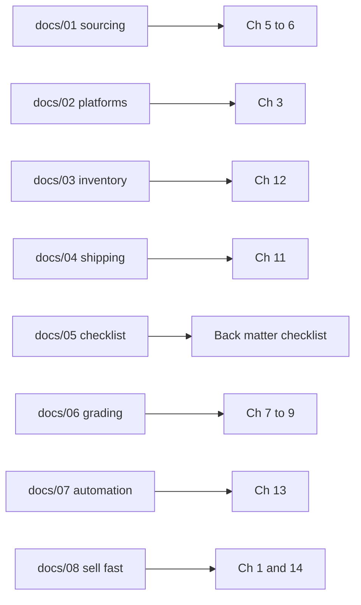
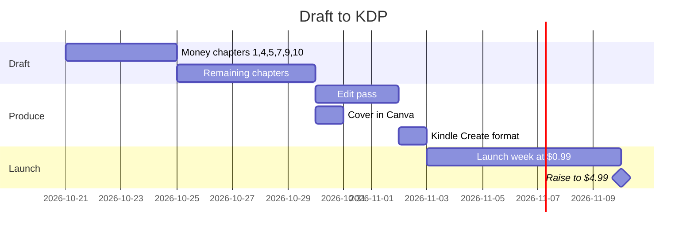

# Thrift to eBay in 30 Days
## A Starter Plan for Vintage Clothing Resale from Small-Town America

Target: 18,000–22,000 words, KDP paperback (6x9) + Kindle. Price $9.99 paperback / $4.99 Kindle.
Angle: a real 30-day plan with real numbers, written by someone starting with under $150 and no big-city Goodwill bins nearby.
Source material: docs/01–08 in this repo. Each chapter maps to a doc so we can draft fast.

### Front matter
- Title page, copyright, short disclaimer (prices as of 2026, not financial advice)
- Who this is for: broke, outside a major city, has a phone and a USPS account

### Part 1 – Before Day 1 (Days 0–3)
1. **The 45-day money rule** (from 08) — turnover beats margin. The $6 → $28 in a week example. Why the ad-fee trap kills beginners (the drone battery story).
2. **Your $100 starting kit** — phone, poly mailers, scale, tape, a white wall. What NOT to buy yet.
3. **Accounts in one afternoon** (from 02, 04) — eBay, Depop, Vinted, Poshmark, USPS business account. Fee table per platform.

### Part 2 – Sourcing (Days 4–10)
4. **What sells in 2 weeks, not 5 months** — vintage sports tees, Levi's, Carhartt, Nike/Starter jackets. The sold-comps habit.
5. **Where to buy when there are no bins near you** (from 01) — wholesale lots under $100, Goodwill half-off days, estate sale last days, Facebook Marketplace lots. Tier 1/2/3 supplier table.
6. **Your first $85 order, step by step** — the exact lot, what arrived, what it sold for (fill in from real results).

### Part 3 – Grading, pricing, listing (Days 11–14)
7. **Spotting real vintage in 10 seconds** (from 06) — single stitch, tag list, copyright years, fabric feel.
8. **The condition scale and the flaw photo rule** (from 06).
9. **Pricing at the 25th percentile** (from 06, 08) — why you price under comps, 20% lower on Depop/Vinted, auto-accept at 85%.
10. **Listing one shirt in 8 minutes** — title formula, 6-photo set, measurements, SKU. Same-day cross-listing on three platforms.

### Part 4 – Shipping and systems (Days 15–20)
11. **Shipping without losing money** (from 04) — USPS Ground Advantage vs Priority, poly mailer weights, buying labels at home.
12. **A free inventory system** (from 03) — the SKU sheet, what to track, the weekly 10-minute review.
13. **Free automation that saves hours** (from 07) — offers to watchers, Gmail sale alerts, relist rhythm.

### Part 5 – Selling out and reloading (Days 21–30)
14. **The relist and price-drop schedule** (from 08) — day 7, 14, 21 moves. Bundles and Whatnot for stragglers.
15. **Handling problems** — returns, double sales, item not as described, lost mail.
16. **Reload math** — what to do with the first $300. When to go from lots to bales.

### Back matter
- 30-day checklist (one page, from 05)
- Supplier list with URLs
- Fee and shipping cheat sheet
- About the author + link to your eBay store

### Production plan
- Draft order: ch 1, 4, 5, 7, 9, 10 first (the money chapters), then the rest.
- ~1,200 words per chapter. Two chapters a day = done in 8 days.
- Cover: Canva, bold text, photo of a stack of tees. Format with Kindle Create (free).
- Launch at $0.99 Kindle for the first week, then $4.99.

## How the book maps to the repo

## Writing schedule

