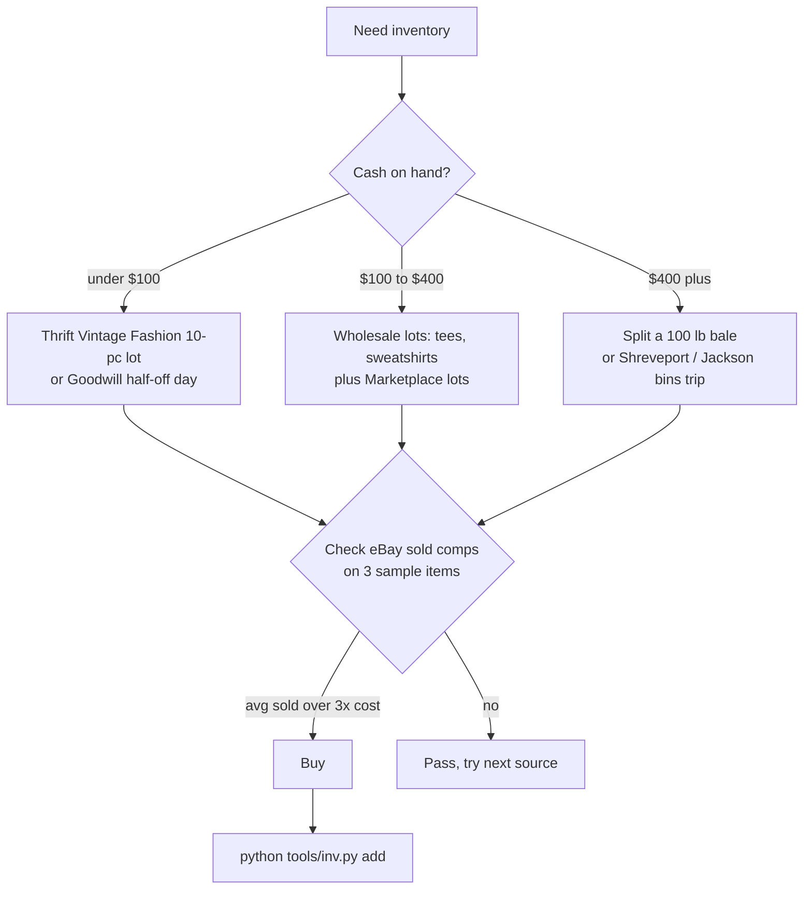
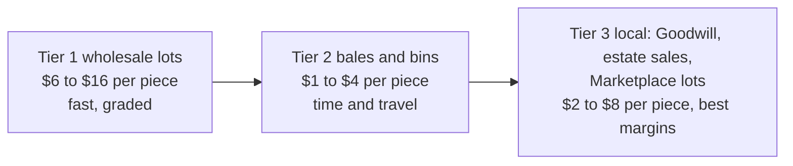

# 01 – Sourcing cheap inventory (vintage sports, men's, women's)

Goal: land inventory at **$2–$12 per piece** average so a $25–$80 sale still clears a healthy margin after fees and shipping.

Prices below were pulled from supplier pages and reseller guides in Oct 2026. Most of these sources are supplier marketing, so order a small lot first and verify before scaling.

## Tier 1: Wholesale vintage and bulk suppliers

| Supplier | Location | How they sell | Notes |
|---|---|---|---|
| **Thrift Vintage Fashion** (your find; the Closo "thrift vintage sports" lots) | Hialeah, FL | 10-pc pro sports tee lots ~$88, 10-pc sweatshirt lots ~$161, mystery boxes, 100 lb bales, bulk program. Also carries women's and general vintage lots. | Final sale, claims within 5 business days. Reviews mention big sizes and some flaws. Good first stop. [Site](https://thriftvintagefashion.com) · [Closo lots](https://closo.co/tools/closo/lot/1900143210) |
| **LA Vintage Wholesale** | Los Angeles | 100 lb bales incl. "Pro Sports" (~$900), women's and brand bales, 500 lb mystery gaylords (~$2,000) | Bigger ticket. Split a bale with another reseller to start. [Site](https://lavintage.com/collections/unisex) |
| **Bulk Vintage Clothing** | Philadelphia | By the pound or bundle, no bales | Hand-picked lots in small quantities |
| **Vintage Supplier / Hissen Vintage** | Online | Brand-sorted bales (Nike, Champion, Carhartt, Levi's, women's 90s/Y2K) | Marketing-heavy; sample first. [Sportswear page](https://vintagesupplier.com/wholesale-vintage-sportswear/) |
| **Closo marketplace** | Online | Lots from many wholesalers, shows resale range + median days to sell | Use it to compare suppliers before buying. [closo.co](https://closo.co) |
| **A&E Used Clothing, Smart Clothing Collections, Global Clothing Industries** | NJ / TN / GA | Graded rag-house bales, 500–2,200 lb, $0.35–$0.90/lb | Cheapest per pound but unsorted and huge. Only once you have volume. |

## Tier 2: Liquidation lots (retail returns and overstock, men's and women's)

| Source | Entry cost | Notes |
|---|---|---|
| **BULQ** (bulq.com) | ~$100 min, lots $100–$500 | Manifested and mystery lots; apparel lots have low defect rates. Easiest liquidation entry. |
| **888 Lots** | ~$150 min | Fixed pricing, apparel focus |
| **Via Trading** (LA) | No minimum, public pricing | Returns/overstock pallets: everyday wear, dresses, activewear, designer. [viatrading.com](https://www.viatrading.com/) |
| **B-Stock** | Auction, no fixed minimum | Retailer-direct (Target, Amazon, Walmart returns). For experienced buyers. |
| **Wholesale Ninjas** | ~$2.47/item on 1,000-item Target pallets | Verify before buying |
| **thredUP Rescue Boxes** | ~$10/box plus shipping | Unsorted women's clothing thredUP rejected; sells out fast. [thredup.com/rescues](https://www.thredup.com/rescues) |
| **ShopGoodwill.com** | Auction, no minimum | Online Goodwill auctions; search "lot" in clothing |

Rule of thumb: a bale or pallet yields roughly a third "good" (list immediately), a third "ok" (bundle or Whatnot), a third rag. Price it accordingly. Avoid any "$99 pallet" from social media ads.

## Tier 3: By-the-pound retail (cheapest per piece, highest effort)

- **Goodwill Outlet "bins"** – $1.29–$1.99/lb clothing in most regions. A tee weighs ~0.5 lb, a dress ~0.75 lb, so **under $1.50 per piece**. Nearest to Monroe: search "Goodwill outlet" for Shreveport, Jackson MS, Little Rock. Go at opening, pick a section, bring gloves. Bins rotate every 15–45 min. No returns, inspect everything.
- **Thrift store tag-color sales** – Goodwill and Salvation Army run 50% off a color each week. Hit men's XL–XXL for Starter, Champion, Carhartt; women's for Free People, Madewell, Anthropologie, Lululemon, Patagonia, Coach/Dooney bags.

## Tier 4: Local, private, and seasonal

- **Estate sales** – estatesales.net. Last day is usually 50% off. Vintage women's wear and furs sit here.
- **Facebook Marketplace / Craigslist lots** – search "clothing lot," "closet cleanout," "vintage lot." Offer a flat price for the bundle.
- **Garage sales and church rummage sales** – April–June and Sept–Oct.
- **Storage unit auctions** – storagetreasures.com. Only with a truck.
- **College town move-out week** – ULM and Louisiana Tech in May.
- **Consignment store buyouts** – shops closing or clearing aged stock will sell by the bag.

## Tier 5: Online arbitrage

- **eBay lots** – search "vintage lot," "women's clothing lot size M," sort newly listed. Bid on badly photographed auctions ending at odd hours.
- **Mercari / Poshmark bundles** – sellers dump multi-item lots cheap. Offer 30% below ask.
- **Whatnot bulk streams** – only buy when you know the seller's grading.

## Fast triage: what to grab

| Grab it | Why |
|---|---|
| Starter, Apex One, Chalk Line, Logo 7, Nutmeg, Salem; Champion reverse weave | 80s/90s sports apparel buyers search by name |
| Single-stitch tees (one stitch row at sleeve/hem) | Pre-late-90s |
| Carhartt, Dickies, Levi's 501/505, Wrangler, Pendleton, LL Bean, Patagonia, North Face | Men's workwear and outdoors: steady sellers |
| Women's: Free People, Anthropologie, Madewell, Reformation, Lululemon, Aritzia, Zara (current), 90s/Y2K slips, leather jackets, denim | Fast movers on Depop and Poshmark |
| Designer bags, boots, denim with intact labels | High dollar, low weight |
| Defunct teams, old logos, local college and minor league | Scarcity, loyal buyers |

| Skip it | Why |
|---|---|
| Modern Nike/Fanatics replica jerseys, Shein, fast fashion basics | Oversupplied, low margins |
| Heavy stains, pit stains, missing snaps, broken zips | Won't sell above cost |
| Fakes (check tags, stitching, fonts) | Platform bans |

## First-month sourcing budget

| Source | Budget | Expected pieces | Landed cost |
|---|---|---|---|
| Thrift Vintage Fashion 10-pc tee + 10-pc sweatshirt lot | ~$250 | 20 | ~$12.50 |
| BULQ or thredUP Rescue women's lot | ~$120 | 30–50 | ~$3 |
| Goodwill bins, 2 trips | ~$80 | 40–60 | ~$1.50 |
| FB Marketplace / estate sale lot | ~$100 | 10–20 | ~$6 |
| **Total** | **~$550** | **100–150** | **~$4.50** |

Sources: [Closo supplier lots](https://closo.co/tools/closo/lot/1900143210), [Thrift Vintage Fashion guide](https://thriftvintagefashion.com/blogs/news/best-wholesale-vintage-clothing-suppliers-in-the-us-2026), [LA Vintage](https://lavintage.com/collections/unisex), [Vintage Supplier](https://vintagesupplier.com/wholesale-vintage-sportswear/), [reselling vendors 2026](https://www.voolist.com/blog/best-reselling-vendors-2026), [Via Trading](https://www.viatrading.com/), [clothing liquidation companies](https://www.upliquidation.com/clothing-liquidation/), [Goodwill bins guide](https://closo.co/blogs/beginner-guides-how-tos/goodwill-bins-where-to-find-the-best-stuff-2025-reseller-s-guide), [sold by the pound](https://closo.co/blogs/inventory-liquidation/sold-by-the-pound).

## Sourcing decision flow

## Source tiers by cost per piece

