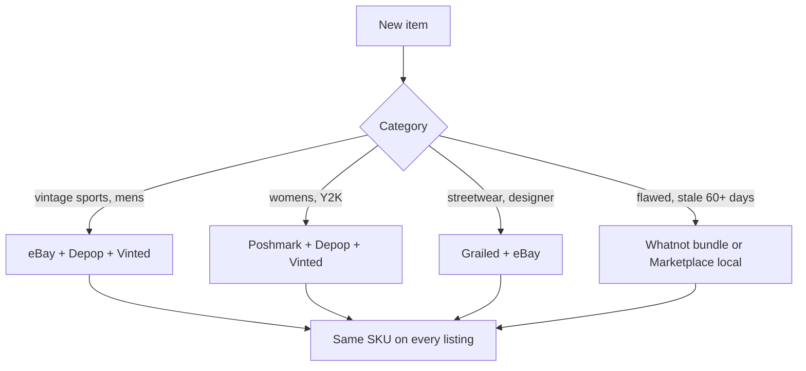
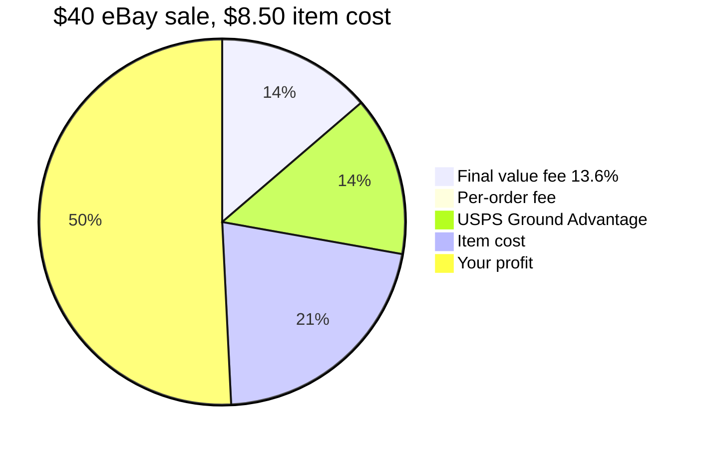

# 02 – Where to sell

Fees as reported Oct 2026. Confirm on each platform's official fee page before pricing.

| Platform | Fee (approx) | Buyer base | Best for |
|---|---|---|---|
| **eBay** | ~13.6% + $0.40/order | Largest, collectors, worldwide | Jerseys, jackets, men's workwear, anything $50+, rare pieces |
| **Depop** | 3.3% + $0.45 processing, **no commission** (US) | Gen Z, fashion-first | Vintage tees, crewnecks, women's 90s/Y2K, anything "aesthetic." Cheapest fees. |
| **Poshmark** | 20% over $15, $2.95 under | Women's-heavy, bundles, brand shoppers | Women's contemporary brands (Free People, Lululemon, Madewell), bags, shoes |
| **Vinted** | **0% to seller.** Buyer pays shipping + ~5% + $0.70 protection fee | Budget and Gen Z shoppers, Europe-born, growing fast in US | Women's everyday brands, basics, kids, anything under $40. Prepaid USPS label comes with the sale. |
| **Whatnot** | 8% + 2.9% + $0.30 (~11–12%) | Live auction, impulse buyers | Clearance: bale leftovers, $10–$30 pieces |
| **Mercari** | ~10% | Bargain shoppers | Mid-tier items, bundles |
| **Grailed** | ~9% + processing (~12–13%) | Menswear/streetwear | Starter, reverse weave, Carhartt, designer menswear $75+ |
| **Instagram / Shopify** | 0% / ~3% | Your followers | Later, once you have an audience |

## Recommended stack

1. **eBay** = anchor for men's, sports, and anything over $50. Highest prices, best search traffic.
2. **Depop** = second listing for every tee, crewneck, jacket, and all women's vintage under $100. Near-zero fees.
3. **Poshmark** = women's contemporary brands. The 20% fee is worth it because that is where those buyers are. Share your closet daily; it drives visibility.
4. **Vinted** = free third listing for everything under $40, especially women's. Zero seller fees and the buyer pays shipping, so even low-dollar pieces net full price. Put the SKU in the description like everywhere else.
5. **Whatnot** = clearance. One show a week to blow out everything unsold at 60 days. Start bids at $5–$10, not $1.
6. **Grailed** = only menswear $75+ from brands those buyers know.

## Listing rules that move clothing

- **Title formula:** `[Era] [Brand] [Item] [Gender] [Size] [Key detail]` e.g. `Vintage 90s Starter Chicago Bulls Satin Bomber Jacket Mens XL` or `Free People Floral Midi Dress Womens M Boho Tiered`.
- **Photos:** front, back, brand tag, size tag, fabric tag, every flaw, laid flat on neutral background, plus one measured flat shot (pit-to-pit and length; for pants: waist, inseam, rise).
- **Always list measurements.** Vintage sizing runs small; measurements kill returns.
- **Condition grading:** use the scale in `06-pricing-and-grading.md` identically on every platform.
- **Offers on:** auto-accept 10–15% below ask on eBay, Depop, Poshmark. Vinted buyers offer hard; price 20% above target there.
- **Put the SKU in every listing** (end of description, or eBay's custom label field). This is what makes cross-platform tracking work.

Sources: [Vinted USA 2026 guide](https://closo.co/blogs/platform-specific-guides/vinted-usa-2026-your-complete-guide-to-the-zero-fee-clothes-marketplace), [Vinted fee calculator](https://vendoo.co/vinted-fee-calculator), [Vinted US reseller guide](https://margeoapp.com/en/blog/vinted-usa-reseller-guide-2026/).

## Where each item goes

## Where $40 goes on an eBay sale

