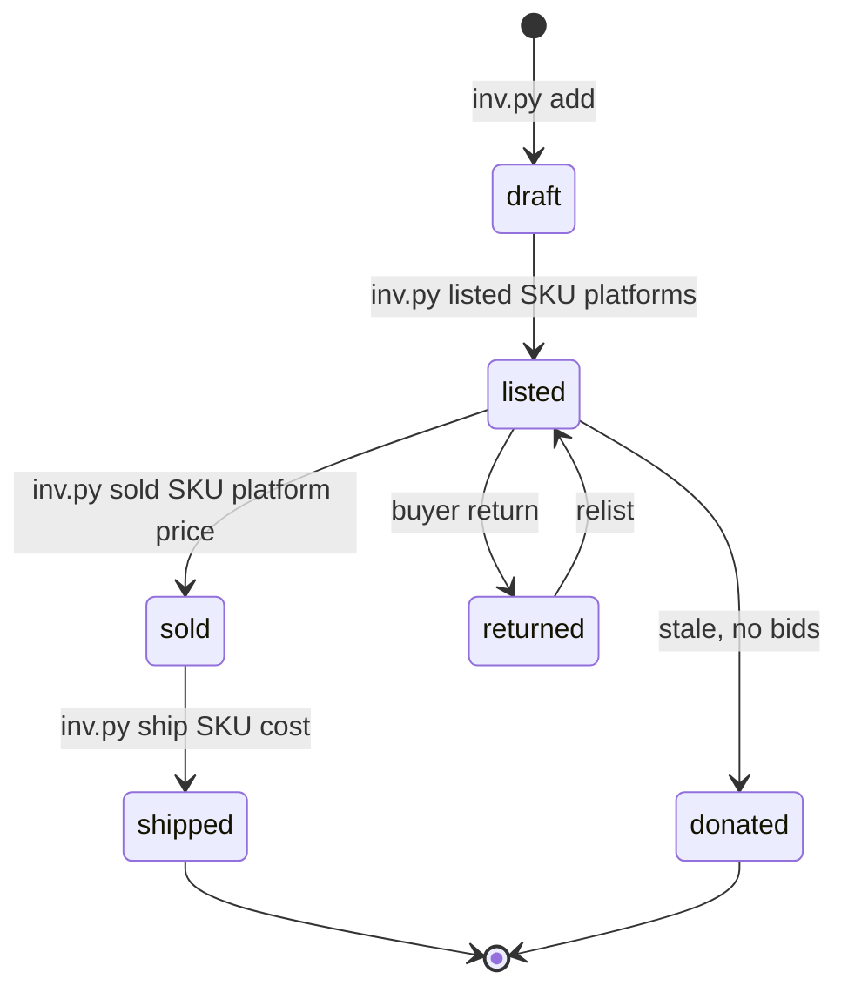
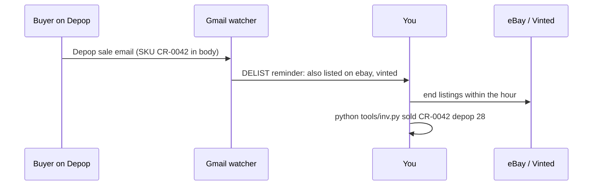

# 03 – Inventory tracking across every platform

The problem: list the same jacket on eBay, Depop, and Poshmark, and it sells on two at once. The fix is one SKU, one source of truth, and a delist-on-sale rule.

## 1. SKU system

Format: `CR-0001`, `CR-0002`, ... (zero-padded). The script in `tools/inv.py` assigns these automatically.

- Write the SKU on a masking tape tag or hang tag on the item.
- Put the SKU in the listing on every platform:
  - eBay: "Custom label (SKU)" field
  - Depop / Poshmark / Vinted / Grailed / Mercari: last line of the description
  - Whatnot: item title or notes
- Store items in numbered bins. The CSV's `location` column says which bin.

## 2. Single source of truth: `inventory/inventory.csv`

| Column | Meaning |
|---|---|
| sku | CR-0001 |
| date_added | YYYY-MM-DD |
| brand, item, category, item_type, size, era, condition | What it is. category = mens / womens / unisex / kids |
| cost | What you paid, including share of lot shipping and tax |
| list_price | Asking price |
| listed_on | pipe-separated: `ebay|depop|poshmark` |
| location | Bin number |
| status | `draft`, `listed`, `sold`, `returned`, `donated` |
| sold_platform, sold_price, sold_date, fees, shipping_cost | Filled at sale |
| notes | Flaws, measurements |

Open it in Excel or Google Sheets any time. Keep one copy. Commit it to this repo weekly for history.

## 3. The sale rule (every single time)

1. Item sells on platform A.
2. Run `python tools/inv.py sold CR-0042 ebay 79.99`. The script marks it sold and prints which other platforms still have it listed.
3. Delist from those platforms **before you pack the item**. Same sitting, no exceptions.
4. Ship, then record shipping cost: `python tools/inv.py ship CR-0042 6.40`.

## 4. When to add a crosslisting tool

Manual works to ~100 active listings. Past that, pay for a crosslister. They copy a listing to other platforms and most auto-delist when an item sells.

| Tool | Approx price | Auto-delist | Notes |
|---|---|---|---|
| **Vendoo** | free (5 items), Starter ~$12–15/mo | Yes on Starter | Easiest; eBay/Depop/Poshmark/Mercari/Grailed/Whatnot. No Vinted. Good first pick. |
| **Flyp** | free 100 days, then ~$9/mo | Yes | Cheapest. Poshmark, eBay, Mercari, Depop. |
| **List Perfectly** | ~$29/mo | Higher tier | Strong for eBay-heavy sellers |
| **Crosslist** | ~$30–45/mo | Higher tiers only | Depop needs browser open; supports Vinted |
| **Voolist** | ~$20/mo | Yes | No Mercari yet |

Recommendation: start manual with the CSV, add **Vendoo Starter** at 100 listings. Keep the CSV regardless: no crosslister tracks cost, bin location, or profit well, and you want the data outside any subscription.

## 5. Weekly routine

- **Monday:** source, photograph, add to CSV as `draft`.
- **Tue–Wed:** list on eBay + Depop (+ Poshmark for women's), run `inv.py listed`, status becomes `listed`.
- **Daily:** check sales on each app, run the sale rule, pack, ship. Share Poshmark closet.
- **Friday:** `python tools/inv.py report`. Anything listed 60+ days gets a price drop or goes into the Whatnot show.
- **Sunday:** `git add inventory && git commit -m "inventory week of ..."`.

Sources: [cross-listing apps 2026](https://www.voolist.com/blog/best-cross-listing-apps-2026), [Vendoo pricing](https://www.nifty.ai/post/vendoo-pricing), [reseller inventory tools](https://resident.com/technology-and-digital-resources/2026/10/16/12-inventory-management-software-tools-for-resellers-in-2026-sorted-by-type).

## 6. When it sells twice anyway (double sale)

1. **Ship to whoever paid first.** Timestamp decides.
2. **Cancel the second order within the hour.** Reason: "item out of stock," never "buyer requested."
3. **Message the second buyer:** sorry, it sold elsewhere minutes earlier, full refund is on its way, 10% off anything else. Most shrug it off.
4. Run `inv.py sold` for the platform that shipped and delist everywhere else immediately.

| Platform | Cost of a cancellation |
|---|---|
| eBay | One "defect." Harmless once or twice; over ~2% of transactions in 12 months loses Top Rated and search rank. Fees refund automatically. |
| Depop, Vinted, Mercari | Refund, no lasting penalty unless repeated. Vinted may show a cancellation count. |
| Poshmark | Cancel before shipping; small rating ding only if repeated. |
| Whatnot | Real hit to seller standing and buyers saw it live. **Never put a cross-listed item in a show.** Delist everywhere the morning of. |

The window is the minutes between the first sale and your delisting. Push notifications on every app, delist before you pack, and a crosslister with auto-delist (Vendoo or Flyp) shrink it to near zero. Auto-delist is the real reason to pay for one.

## Item lifecycle

## Double-sale prevention

