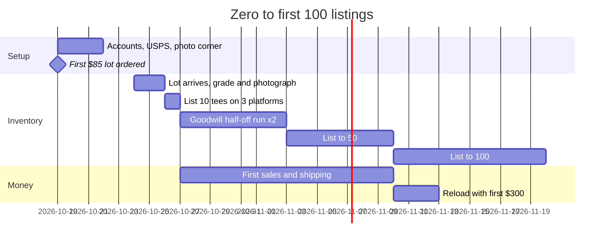
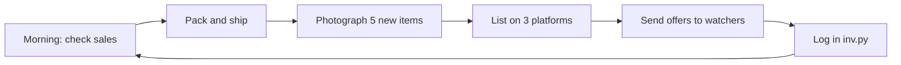

# 05 – Launch checklist (first 30 days)

## Week 1: Setup
- [ ] Pick a brand name and handle; grab it on eBay, Depop, Poshmark, Whatnot, Instagram
- [ ] eBay: business account, link bank, 30-day returns (buyer pays return shipping), 1-day handling
- [ ] Depop, Poshmark, and Vinted seller accounts, bios linking Instagram
- [ ] Whatnot: apply as seller (approval takes a few days)
- [ ] Pirate Ship account linked to USPS account
- [ ] Gear: kitchen scale, poly mailers (100), tape, hang tags, 5 numbered bins, phone tripod, neutral backdrop
- [ ] Order free USPS Priority Flat Rate supplies
- [ ] `python tools/inv.py init`
- [ ] Separate business checking account (see `banking/`)

## Week 2: First inventory
- [ ] Thrift Vintage Fashion 10-pc tee lot + 10-pc sweatshirt lot (~$250)
- [ ] One BULQ apparel lot or thredUP Rescue box for women's (~$120)
- [ ] Two Goodwill bin trips (~$80)
- [ ] One FB Marketplace closet lot (~$100)
- [ ] Grade, measure, tag, photograph everything, add to CSV

## Week 3: List
- [ ] 75+ listings live on eBay
- [ ] Same on Depop; women's contemporary also on Poshmark; everything under $40 also on Vinted
- [ ] Auto-accept offers at 85% of ask
- [ ] Post best 5 pieces on Instagram

## Week 4: Sell and learn
- [ ] First Whatnot show with the lowest-grade 20 pieces
- [ ] `python tools/inv.py report`: which categories and brands sold fastest
- [ ] Reorder from whichever source gave the best sell-through
- [ ] Commit inventory CSV

## Legal/tax basics (Louisiana)
- Register an LLC with the Louisiana Secretary of State via geauxBIZ (~$100 filing). Needed for a business bank account and loan.
- Louisiana sales tax: register with LDR via LaTAP. Marketplaces collect and remit for you, but you still file (often $0) returns.
- Track every expense (mileage to bins counts). Platforms issue a 1099-K; the CSV cost column is your deduction record.

## 30-day launch timeline

## Daily loop once live

