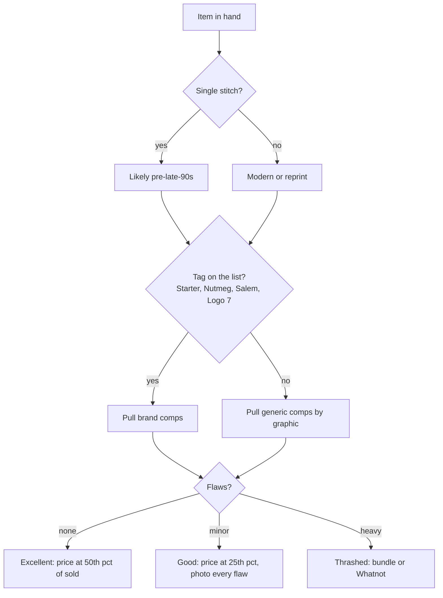
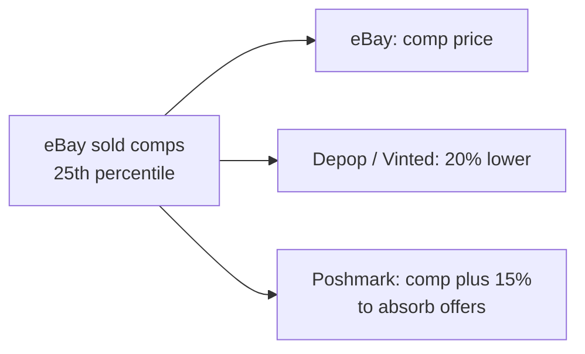

# 06 – Grading and pricing

## Condition scale (use on every platform)

| Grade | Meaning |
|---|---|
| **NWT / Deadstock** | Unworn, tags attached |
| **Excellent** | Worn, no visible flaws |
| **Very good** | Light fade or wash wear, no holes/stains |
| **Good** | Minor flaws: small hole, light stain, pilling. Photograph every flaw. |
| **Fair / Thrashed** | Heavy distress. Sell as "thrashed" or bundle. |

## Spotting real vintage
- **Single stitch** hem/sleeves: pre-late-90s.
- **Tags:** Starter, Nutmeg Mills, Salem, Logo 7, Chalk Line, Apex One; women's: ILGWU union tags (pre-1995), "Made in USA," Gunne Sax, Jessica McClintock, Limited Too, Express Tricot.
- **Copyright year** printed next to league or band logos.
- **Fabric:** thick boxy 100% cotton = 90s; 50/50 thin blends = 80s.
- **Fakes:** modern tagless prints, wrong fonts, reprints on Gildan blanks, designer bags with uneven stitching.

## Pricing method

1. Search the exact item on eBay, filter **Sold Items**. Use the median of the last 10 sales.
2. Check Depop/Poshmark sold for the same brand to see the fashion premium.
3. Price 10–15% above target since buyers will offer.
4. Floor = (cost + shipping + fees) ÷ 0.6. Nothing lists below that.

## Rough comps (check sold listings, these shift)

| Item | Typical sold range |
|---|---|
| Vintage team tee, single stitch, good+ | $25–$60 |
| Champion reverse weave team crewneck | $40–$90 |
| Starter satin or pullover jacket, 90s | $60–$200 |
| Vintage snapback, Sports Specialties | $30–$100 |
| Authentic 90s jersey | $60–$300+ |
| Carhartt chore coat / detroit jacket | $50–$150 |
| Levi's 501 vintage, USA made | $40–$120 |
| Free People / Anthropologie dress | $25–$70 |
| Lululemon leggings / jacket | $25–$80 |
| Madewell / Reformation | $20–$90 |
| Patagonia fleece | $40–$120 |
| Coach / Dooney vintage leather bag | $40–$150 |
| Modern replica jersey, fast fashion | $10–$25 (skip) |

## Price drop schedule
- Day 30 unsold: drop 10%.
- Day 60: drop 15% more or send to Whatnot show.
- Day 90: Whatnot, bundle, or donate (log as `donated` to track the loss).

## Grade and price in under two minutes

## Price ladder by platform

