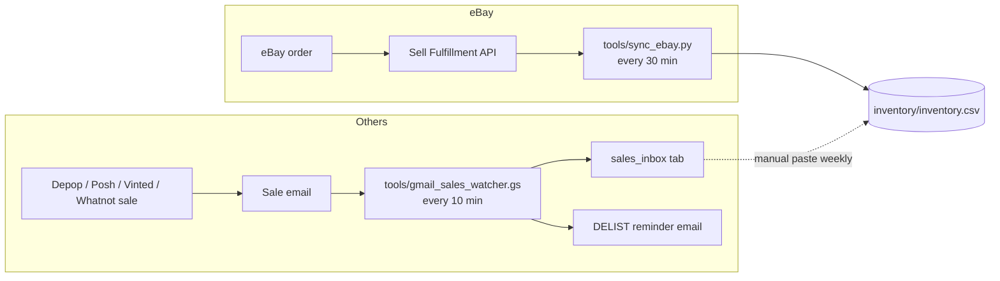
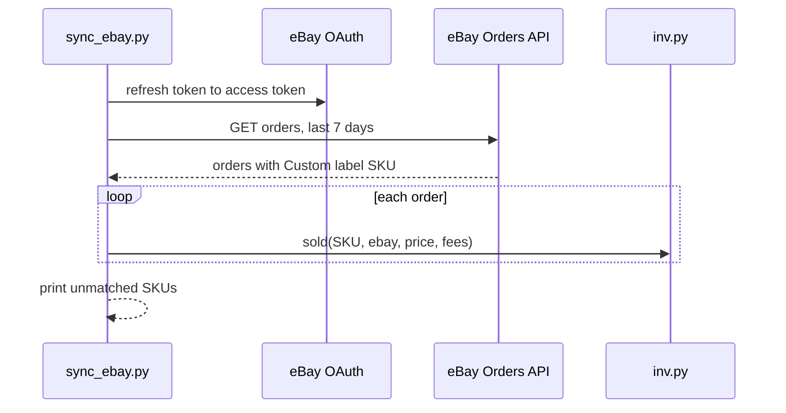
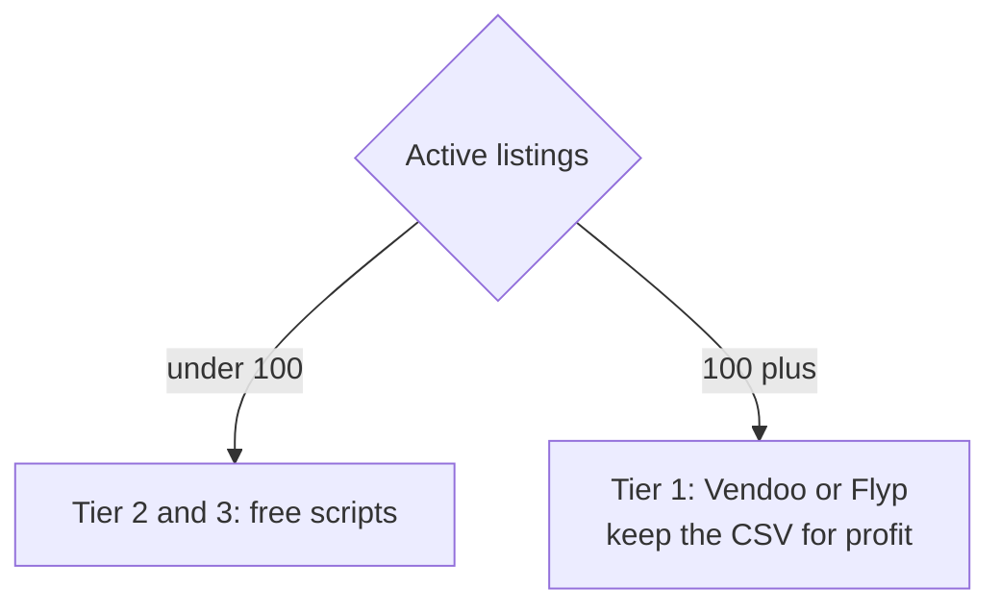

# 07 – Automatic inventory tracking

What can and cannot be automated, honestly:

| Platform | Public API? | Sale detection | Auto-delist |
|---|---|---|---|
| eBay | Yes (Sell APIs) | Fully automatic via `tools/sync_ebay.py` | Via API (crosslisters do it) |
| Depop | No | Sale-notification email only | Crosslister (browser automation) |
| Poshmark | No | Sale-notification email only | Crosslister |
| Whatnot | No | Sale-notification email only | Crosslister |
| Vinted | No | Sale-notification email only | Vendoo dropped Vinted; Crosslist supports it |
| Mercari, Grailed | No | Sale-notification email only | Crosslister |

So there are three tiers. Pick based on how much you want to pay and how many listings you have.

## Tier 1: Pay a crosslister (easiest, truly automatic)

**Vendoo** (~$12–15/mo Starter) or **Flyp** (free 100 days, then ~$9/mo). You list once, it posts to every platform, detects the sale, and delists everywhere else within minutes. This is the only option that removes the delist step entirely. Recommendation: switch to this the moment you cross 100 active listings. Export its sales CSV monthly and import into your tracker to keep profit data.

Keep `inventory/inventory.csv` anyway. No crosslister tracks cost per item, bin location, or profit well.

## Tier 2: eBay auto-sync (free, built here)

`tools/sync_ebay.py` pulls your eBay orders through the official Fulfillment API and marks matching SKUs sold in the CSV. Run it on a schedule and eBay sales track themselves.

**One-time setup (~20 minutes):**

1. Go to developer.ebay.com, sign in with your eBay account, and create an application (Production keyset). Note the **Client ID (App ID)** and **Client Secret (Cert ID)**.
2. In the keyset page, click "User Tokens", choose "Get a User Token" via OAuth, and add the scope `https://api.ebay.com/oauth/api_scope/sell.fulfillment`. Complete the consent flow and copy the **refresh token** (lasts ~18 months).
3. Create `tools/ebay_config.json` (already git-ignored):
   ```json
   {"client_id": "YOUR-APP-ID", "client_secret": "YOUR-CERT-ID", "refresh_token": "v^1.1#...", "lookback_days": 7}
   ```
4. Test: `python tools/sync_ebay.py --dry-run`
5. On every eBay listing, put the tracker SKU (e.g. `CR-0042`) in the **Custom label (SKU)** field. That is how orders map to rows.

**Schedule it on Windows** (runs every 30 minutes, prints delist reminders to a log):

```powershell
$act = New-ScheduledTaskAction -Execute "python" -Argument "C:\Users\wbp31\clothing_resale\tools\sync_ebay.py >> C:\Users\wbp31\clothing_resale\inventory\sync.log 2>&1"
$trig = New-ScheduledTaskTrigger -Once -At (Get-Date) -RepetitionInterval (New-TimeSpan -Minutes 30)
Register-ScheduledTask -TaskName "ResaleEbaySync" -Action $act -Trigger $trig
```

Check `inventory/sync.log` or run the script by hand to see "DELIST from DEPOP" lines.

## Tier 3: Email watcher for everything else (free, built here)

`tools/gmail_sales_watcher.gs` is a Google Apps Script that runs in your Gmail every 10 minutes. It finds sale emails from Depop, Poshmark, Vinted, Whatnot, Mercari, Grailed, and eBay, logs each to a Google Sheet tab, matches it to your inventory by SKU (or by title if no SKU), and emails you a reminder naming the platforms to delist from.

**Setup (~10 minutes):**

1. Make sure sale notifications are turned on in each app and go to the Gmail account you'll use.
2. Create a Google Sheet. File > Import > upload `inventory/inventory.csv` into a tab named `inventory`.
3. Extensions > Apps Script. Delete the default code, paste in `tools/gmail_sales_watcher.gs`, set `SHEET_ID` (the long ID in the sheet URL).
4. Select the `setup` function and click Run. Approve the permissions. That creates the `sales_inbox` tab and the 10-minute trigger.
5. Put the SKU as the **last line of every listing description** on Depop, Poshmark, Vinted, Whatnot, Mercari, Grailed. Matching is exact when the SKU is in the email and fuzzy otherwise.

After a sale email arrives you get an email like:

```
[DEPOP] CR-0042  Starter Bulls Satin Jacket XL  $79
   >>> DELIST NOW from: EBAY, POSHMARK
```

Then record it in the master CSV: `python tools/inv.py sold CR-0042 depop 79`. (Or make the Google Sheet your master instead of the CSV: the script reads from it, and `inv.py` can be pointed at an exported copy.)

**Caveat:** the email subject patterns in `SOURCES` match the wording each platform used as of Oct 2026. If a platform changes its email template, update the query line. Unmatched sales still appear in `sales_inbox` with status `UNMATCHED`, so nothing is silently lost.

## Recommended path

1. Month 1 (under 100 listings): manual CSV + email watcher. Free.
2. Add the eBay sync as soon as you have 20+ eBay listings. Free.
3. At 100+ listings: Vendoo or Flyp for auto-delist. Keep the CSV for profit tracking.

## How sales get detected



## eBay sync sequence



## Which tier to use


