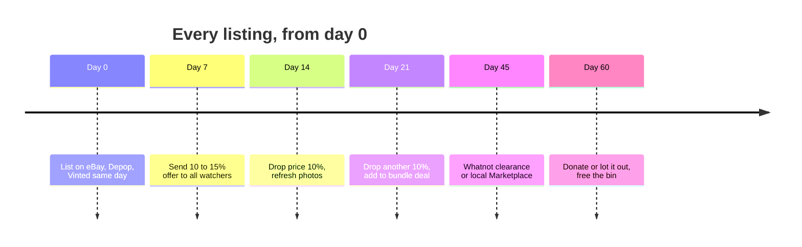
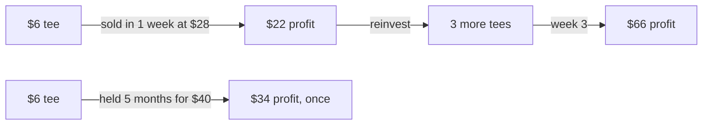

# 08 – Selling fast (turnover beats margin)

The goal is money doubling every 45 days, not the maximum price on any one item. A $6 piece sold at $28 in a week beats $40 in five months because the $22 becomes the next lot.

## Ad fees: the rules

- **Never use eBay Promoted Listings General at the suggested rate.** Suggested rates run 8–12% and stack on top of the 13.6% final value fee. For clothing under $50, do not promote at all. Buyers find clothing by brand + size search.
- If you ever promote, set the rate manually at **2%**, and only on items over $75.
- **"Send offers to watchers"** on eBay is free. Send 10–15% off to every watcher, every time eBay lets you.
- **Auto-accept offers** on every platform at 85% of ask so buyers close themselves while you sleep.

## Channel speed ranking

| Channel | Typical time to sell | Use for |
|---|---|---|
| **Whatnot live show** | 30–60 seconds per item | Anything 30+ days old; bale leftovers. Start bids $5–$8. |
| **Depop** (priced 20% under eBay comp) | Days | Tees, crewnecks, jackets, women's vintage. Relist stale items every 2 weeks; relisted = "new" in the feed. |
| **Vinted** (zero seller fee) | Days to 2 weeks | Everything under $40, especially women's |
| **eBay 7-day auction**, start at floor, end Sunday 7–9pm CT | 7 days | Items with 5+ sold comps; auctions create urgency |
| **Bundles / lots** | Days | 3–5 slow singles as one "90s lot" |
| eBay fixed price | Weeks to months | Only $75+ collector pieces |

## Price for speed

1. eBay sold comps, last 10 sales. Take the **25th percentile**, not the median.
2. That is your ask on eBay. On Depop and Vinted, go 20% under it; their fees are near zero so you net the same.
3. Floor = (cost + shipping + fees) ÷ 0.6. Auctions start here.

## Staleness schedule (nothing older than 60 days)

| Day | Action |
|---|---|
| 0 | List on eBay + Depop + Vinted (Poshmark for women's brands) |
| 14 | Relist on Depop. Send offers to watchers on eBay. |
| 30 | Drop 15% everywhere. `python tools/inv.py list` flags these. |
| 45 | Into the weekly Whatnot show |
| 60 | Bundle whatever is left, or donate and log it |

## Weekly Whatnot show recipe

- Same night each week, 60–90 minutes, 30–50 items pre-tagged in order.
- First 5 items: your best pieces at $5 start to pull viewers in.
- Middle: everything stale, $5–$8 starts.
- Last 10: bundles and "mystery" lots.
- Ship everything the next morning in one USPS pickup.

## Staleness schedule

## Turnover beats margin

