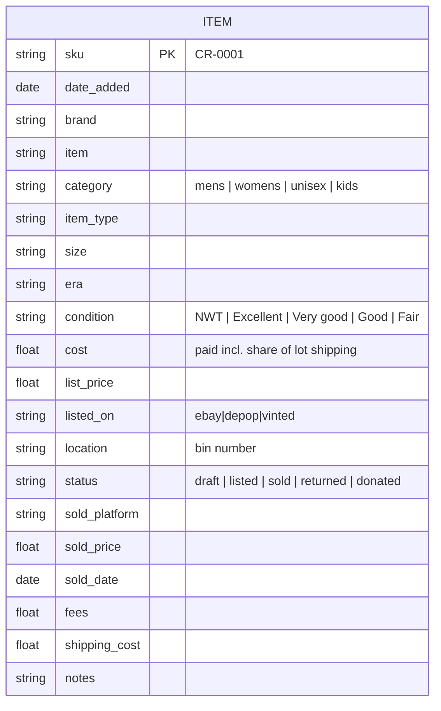
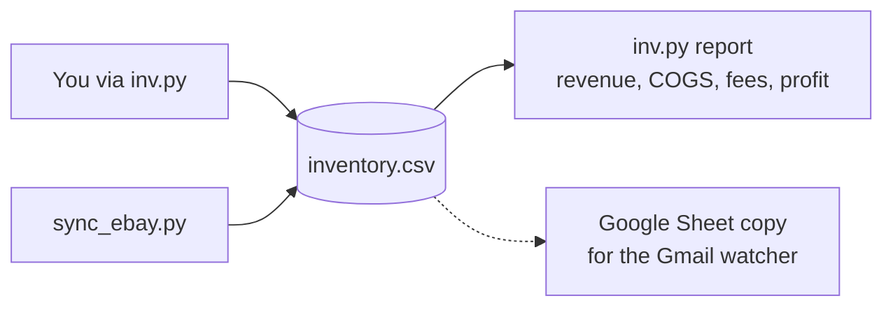

# inventory

`inventory.csv` is the single source of truth for every item. Never edit `sku` or `status` by hand; use `tools/inv.py`. Everything else can be edited in Excel or Sheets.

## Columns

## Who writes to it

`sync.log` is written by the scheduled eBay sync and is git-ignored.
