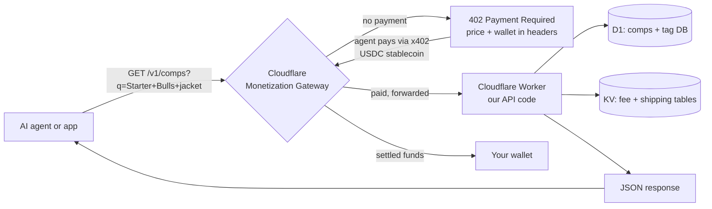
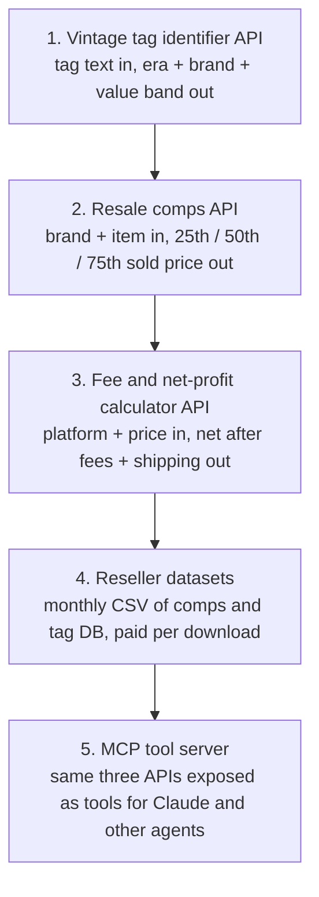

# Monetization: paid APIs behind the Cloudflare Monetization Gateway

Idea: turn the data and know-how in this repo into small, paid, machine-readable services that AI agents and other apps pay for per call. Cloudflare's **Monetization Gateway** (waitlist opened July 1, 2026) sits in front of a Cloudflare Worker and collects payment at the edge via the **x402** protocol, so there is no Stripe setup, no invoices, no billing code. You set a price per route the same way you write a WAF rule.

Status as of Oct 2026: waitlist only. No public launch date and Cloudflare has not published its cut. Plan: build the APIs now on a free Workers account, ship them free or with a plain API key, and flip the paid rules on the day the gateway opens.

## Why this fits the resale business

- **Zero inventory, zero shipping.** Code runs once and sells forever.
- **We already own the data.** Sold comps, vintage tag database, platform fee tables, shipping cost tables, and the pricing rules in `docs/06` and `docs/08` are exactly the things an AI shopping or reseller agent needs and cannot easily get.
- **Barrier to entry is a laptop.** Cloudflare Workers free tier covers 100,000 requests a day. Domain is about $10 a year.

## Folder map

| File | What it is |
|---|---|
| [docs/01-how-it-works.md](docs/01-how-it-works.md) | Gateway and x402 explained with diagrams, and what you need to sign up |
| [docs/02-api-ideas.md](docs/02-api-ideas.md) | Ranked list of APIs and data products we can sell, with pricing |
| [docs/03-build-plan.md](docs/03-build-plan.md) | 30-day build order, Gantt, and the free-tier stack |
| [docs/04-revenue-math.md](docs/04-revenue-math.md) | What this realistically earns at different call volumes |
| [worker/README.md](worker/README.md) | Skeleton Worker for the first API (vintage tag identifier + comps) |

## Architecture at a glance

## The five products, in build order

Start with product 1 because the data is already in `docs/06-pricing-and-grading.md`, it needs no live scraping, and it is the thing a shopping agent asks first: "is this real vintage and what is it worth?"

## Non-negotiables

- Everything ships free first behind a plain API key so we have users on day one.
- No scraping eBay against its terms. Comps come from the official eBay Browse and Marketplace Insights APIs or from our own logged sales.
- Keep the Worker under the free tier until the first paid call lands.

Sources: [Cloudflare launches Monetization Gateway charging AI agents](https://letsdatascience.com/news/cloudflare-launches-monetization-gateway-charging-ai-agents-236fcb92), [How to charge AI agents for your API in 2026: x402 and Cloudflare's Monetization Gateway](https://dev.to/mr_manushukla/how-to-charge-ai-agents-for-your-api-and-content-in-2026-x402-and-cloudflares-monetization-gateway-51hh), [Build vs buy on the Monetization Gateway](https://www.buildmvpfast.com/blog/cloudflare-monetization-gateway-x402-build-vs-buy-2026), [Stellagent key takeaways](https://stellagent.ai/insights/cloudflare-monetization-gateway-x402).
