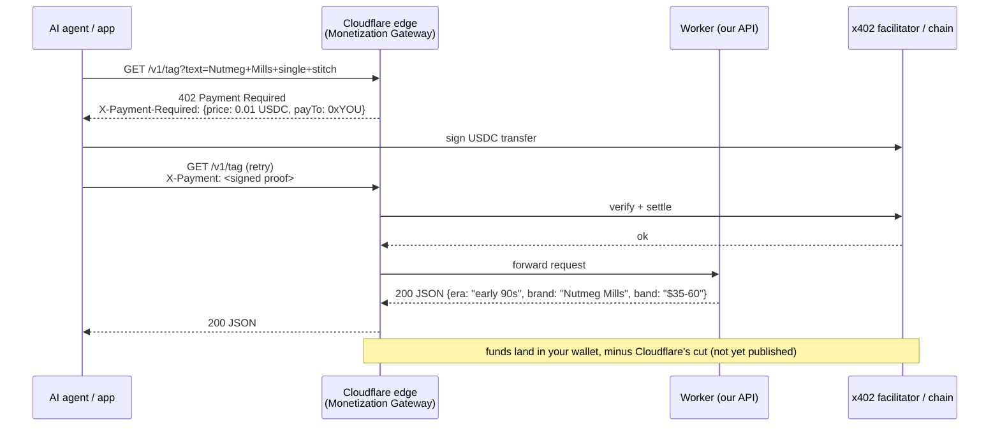
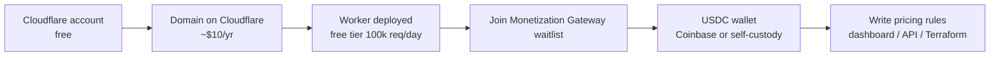

# 01 – How the Monetization Gateway and x402 work

## Plain version

1. You put a Worker (or any site) behind Cloudflare.
2. In the dashboard you write a rule: "requests to `/v1/*` cost $0.01."
3. An AI agent calls your URL. Cloudflare answers **402 Payment Required** with the price and your wallet address in the headers.
4. The agent's wallet pays in a stablecoin (USDC) using the x402 protocol and retries the call with a payment proof header.
5. Cloudflare verifies the payment at the edge, forwards the request to your Worker, and settles the money to your wallet.

Your code never touches money. It just answers requests.

## Sequence



## What you need



## Rules look like WAF rules

Example of the kind of rule the gateway uses (syntax from third-party write-ups, confirm against Cloudflare docs when you get access):

```
(http.request.uri.path matches "^/v1/comps") -> price 0.01 USD per request
(http.request.uri.path matches "^/v1/dataset") -> price 2.00 USD per request
(http.request.uri.path eq "/health") -> free
```

## Caveats, stated plainly

- **Waitlist only.** No launch date and no published fee as of Oct 2026.
- **Buyers must have x402 wallets.** Today that is mostly AI agent frameworks and developers, not the general public. This is a bet on agent traffic growing.
- **Fallback is required.** Every route also accepts a plain API key so human developers can pay you with a normal Stripe link until x402 is common. See `docs/03-build-plan.md`.
- **AWS has a similar WAF feature** (June 2026). If Cloudflare's product stalls, the same Worker code can move.

## Alternatives that work today

| Option | Works now | Effort | Notes |
|---|---|---|---|
| Cloudflare Monetization Gateway | Waitlist | Lowest | Edge billing, no code |
| x402 DIY (open-source middleware in the Worker) | Yes | Medium | You run the 402 handshake yourself with the x402 facilitator |
| RapidAPI marketplace listing | Yes | Low | They bill; take ~20% |
| Stripe metered billing + API keys | Yes | Medium | Standard; human developers only |
