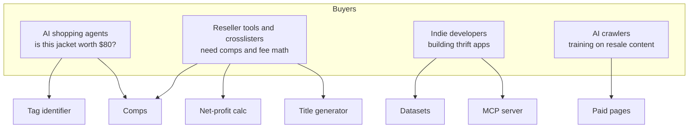
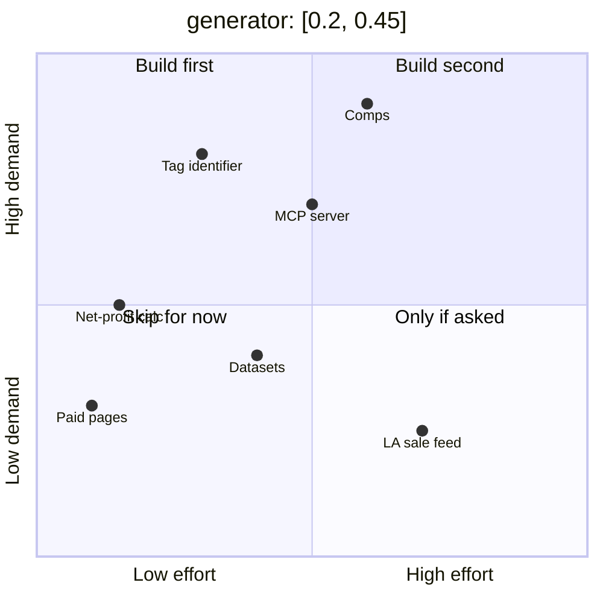

# 02 – What we can sell behind the gateway

Ranked by: do we already have the data, is there an agent that would call it, and can it ship in a week.

| # | Product | Input | Output | Price per call | Data source we already have | Ship in |
|---|---|---|---|---|---|---|
| 1 | **Vintage tag identifier** | Tag text or photo OCR, stitch type, fabric blend | Era, maker, authenticity score, value band | $0.01 | `docs/06` tag list, grown with every item we log | 1 week |
| 2 | **Resale comps** | Brand, item, size, condition | 25th / 50th / 75th sold price, days-to-sell | $0.02 | eBay Marketplace Insights API + our `inventory.csv` sales | 2 weeks |
| 3 | **Net-profit calculator** | Platform, sale price, weight, zone | Fees, shipping, net, margin | $0.005 | `docs/02` fee table, `docs/04` USPS table | 3 days |
| 4 | **Listing title generator** | Brand, item, era, size, flaws | Platform-specific title and description with SKU line | $0.01 | `docs/08` title formula | 3 days |
| 5 | **Reseller datasets** | none | Monthly CSV: comps, tag DB, fee tables | $2.00 per download | Products 1–3 | After 1–3 |
| 6 | **MCP tool server** | tool calls | Same as 1–4 as agent tools | $0.01 per tool call | Products 1–4 | 1 week after 4 |
| 7 | **Louisiana thrift and estate-sale feed** | zip radius | Upcoming sales, store half-off days | $0.01 | Hand-curated to start | 2 weeks |
| 8 | **Paid pages, not APIs** | n/a | The book chapters and sell-fast playbook, charged per page crawl | $0.005 per page | `book/`, `docs/` | 1 day once gateway opens |

## Who pays

## Scoring

## Ideas we are not doing

- Scraping Depop, Poshmark, or eBay HTML for comps. Against their terms and the gateway's own rules.
- Anything that needs us to hold customer money or ship a physical good.
- Reselling other people's datasets.
