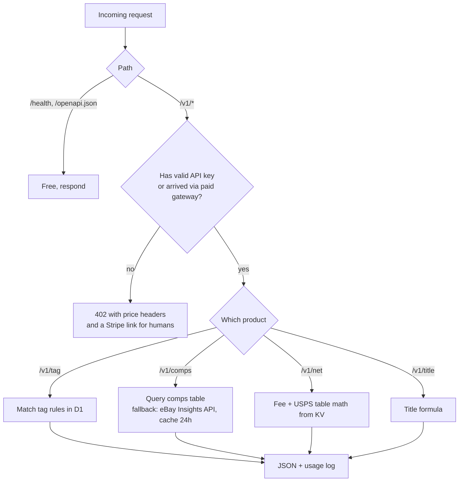
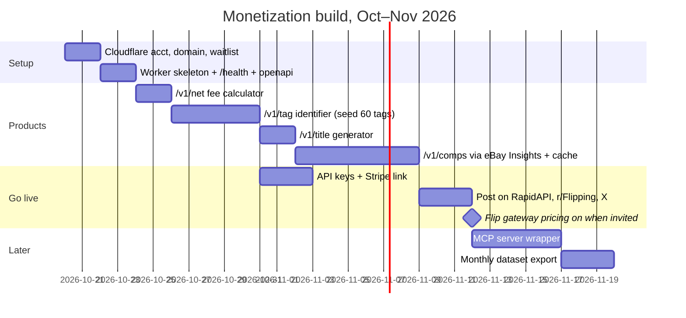
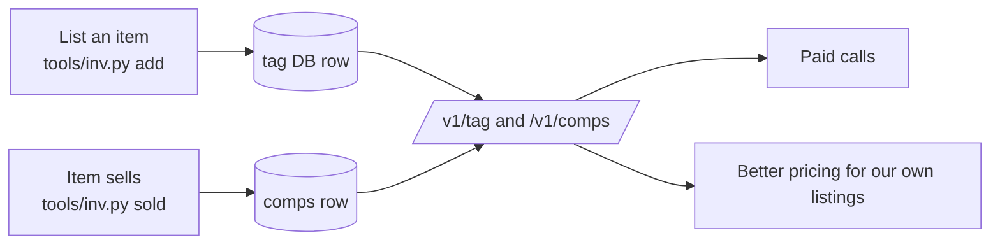

# 03 – Build plan (30 days, free tier)

## Stack

| Layer | Pick | Cost |
|---|---|---|
| Compute | Cloudflare Workers (JavaScript) | Free to 100k req/day |
| Database | Cloudflare D1 (SQLite) for comps and tag DB | Free to 5 GB |
| Cache / tables | Cloudflare KV for fee and shipping tables | Free to 100k reads/day |
| Billing, agents | Monetization Gateway + x402 | Waitlist; cut unpublished |
| Billing, humans | API key + Stripe payment link, 1,000 calls for $5 | Stripe 2.9% + 30¢ |
| Docs | OpenAPI JSON served at `/openapi.json` | Free |
| Domain | something short, on Cloudflare registrar | ~$10/yr |

## Request flow inside the Worker

## Schedule

## Day-by-day for week one

1. Create Cloudflare account, buy domain, join the Monetization Gateway waitlist, install `wrangler`.
2. `wrangler init` the Worker in `monetization/worker/`, deploy `/health`.
3. Load `docs/02` fee table and `docs/04` USPS table into KV. Ship `/v1/net`.
4. Seed D1 with the tag list from `docs/06`. Ship `/v1/tag` with exact and fuzzy match.
5. Add API-key check, usage log in D1, Stripe payment link for keys.
6. Write `/openapi.json` by hand. Post the free tier in r/Flipping and the Depop sellers Discord.
7. Rest. Log every tag from the first tee lot into D1 as you list them.

## Growing the data for free

Every item you list for the clothing business adds a row to the tag DB and, when it sells, a comp. The resale business feeds the API and the API feeds the resale business.

