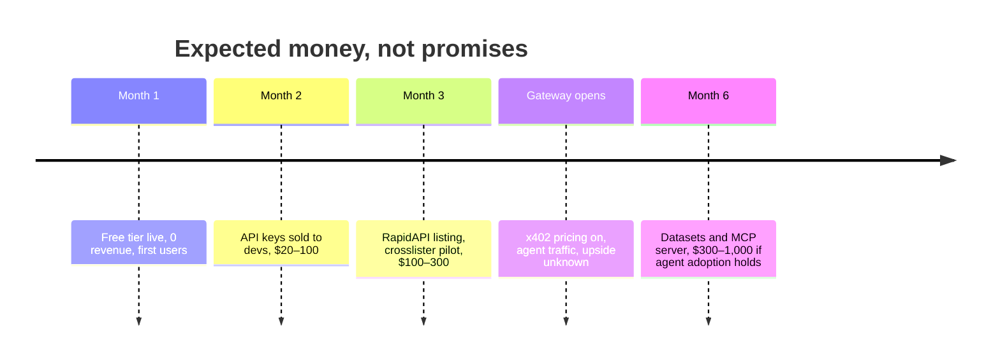

# 04 – Revenue math, honestly

Assumptions: average $0.012 per paid call across products, Cloudflare cut unknown so assume 20%, Workers free tier up to 100k requests a day.

| Paid calls per day | Gross per month | After 20% cut | What that volume means |
|---|---|---|---|
| 100 | $36 | $29 | One agent framework or two indie apps using us |
| 1,000 | $360 | $288 | Listed on RapidAPI and one crosslister integrates |
| 10,000 | $3,600 | $2,880 | Several agent platforms; still inside free tier |
| 50,000 | $18,000 | $14,400 | Paid Workers plan needed, $5/mo plus ~$0.30 per million |

Add the human side: API keys at $5 per 1,000 calls. Twenty developers buying one pack a month is $100.

## Break-even

Fixed costs are a domain (~$10 a year) and nothing else until 100k calls a day. Break-even is the first paid call.

## Timeline of money

## What kills it

- Gateway never launches or takes a big cut. Mitigation: Stripe keys and RapidAPI work regardless.
- Nobody wants vintage comps from an unknown. Mitigation: free tier plus posting real results from our own sales.
- eBay Insights API access denied. Mitigation: our own logged sales plus manual comp entry; slower but ours.
