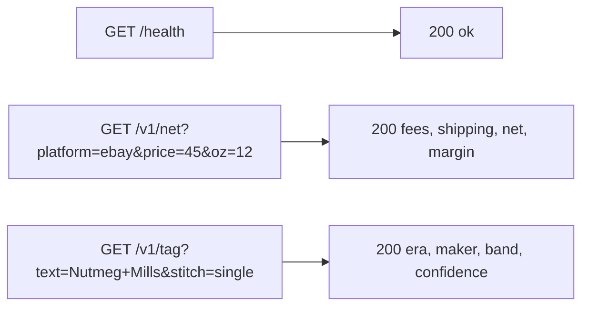
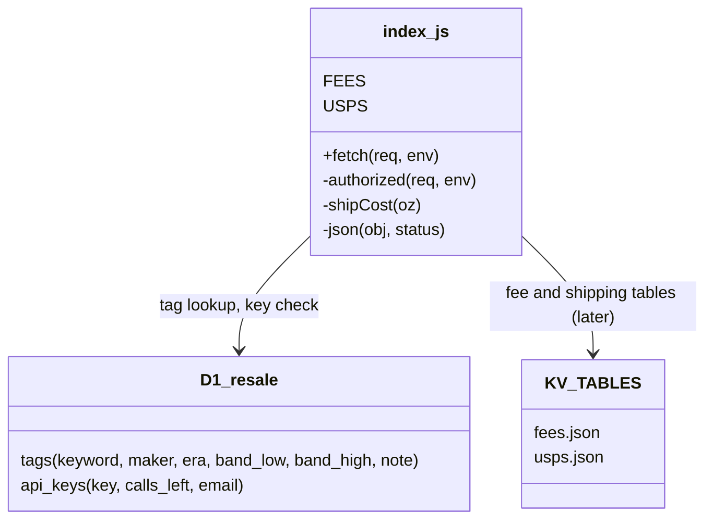

# Worker skeleton

Minimal Cloudflare Worker for the first two routes. No payment code: the Monetization Gateway handles x402 in front of it, and the API-key check covers human developers.

## Files

| File | Purpose |
|---|---|
| `src/index.js` | Router, API-key check, `/health`, `/v1/net`, `/v1/tag` |
| `wrangler.toml` | Worker name, D1 and KV bindings |
| `seed/tags.sql` | Tag rules seeded from `docs/06-pricing-and-grading.md` |

## Run

```
npm create cloudflare@latest -- --template hello-world   # once, then replace src/index.js
npx wrangler d1 create resale                            # paste the id into wrangler.toml
npx wrangler d1 execute resale --file seed/tags.sql
npx wrangler kv namespace create TABLES
npx wrangler dev
npx wrangler deploy
```

## Routes



## Module layout


