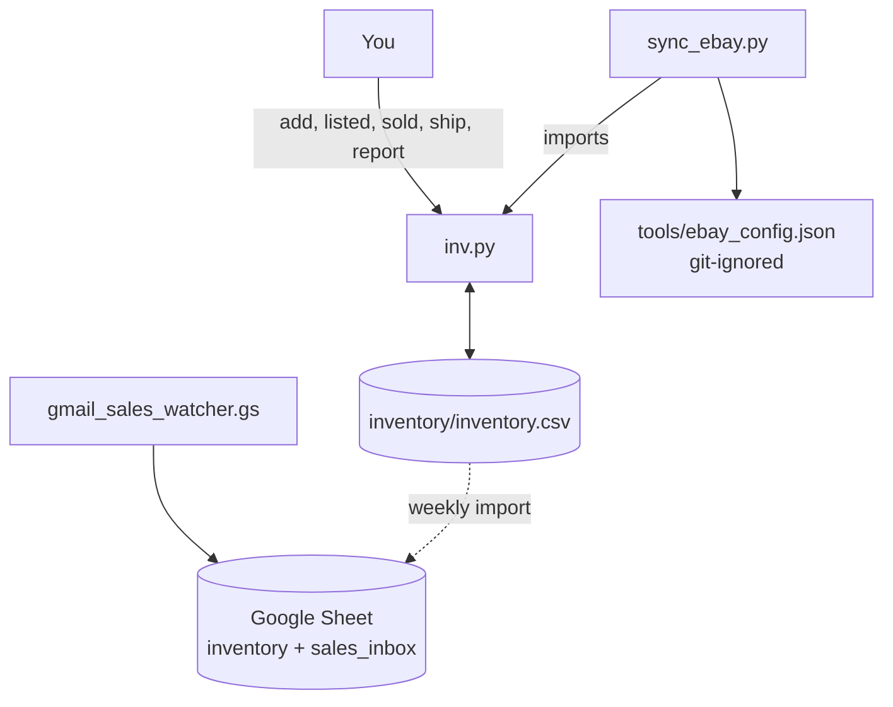
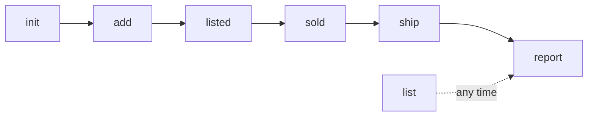
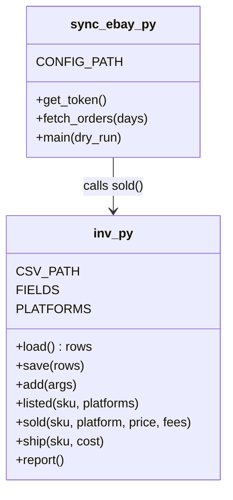

# tools

| File | Runs where | Does |
|---|---|---|
| `inv.py` | Your PC, Python 3.8+, no deps | Inventory CLI over `inventory/inventory.csv` |
| `sync_ebay.py` | Your PC, scheduled every 30 min | Marks eBay orders sold via the Sell Fulfillment API |
| `gmail_sales_watcher.gs` | Google Apps Script, every 10 min | Parses sale emails from the no-API platforms, emails delist reminders |

## How they fit together

## inv.py command order

## inv.py internals

Setup for `sync_ebay.py` and the Gmail script is in `docs/07-automation.md`.
